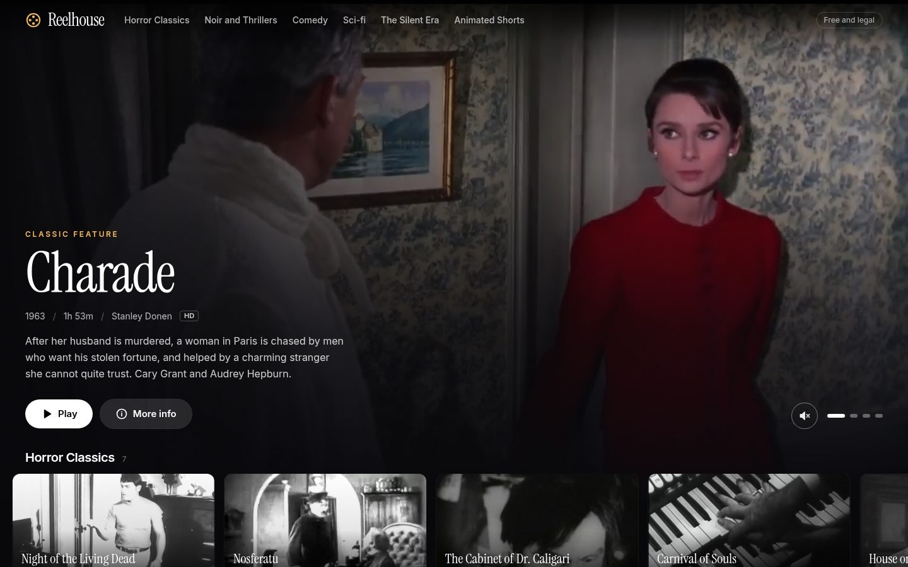
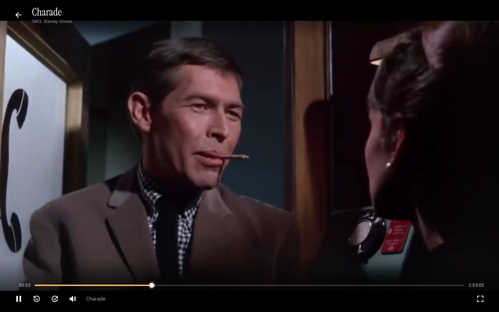
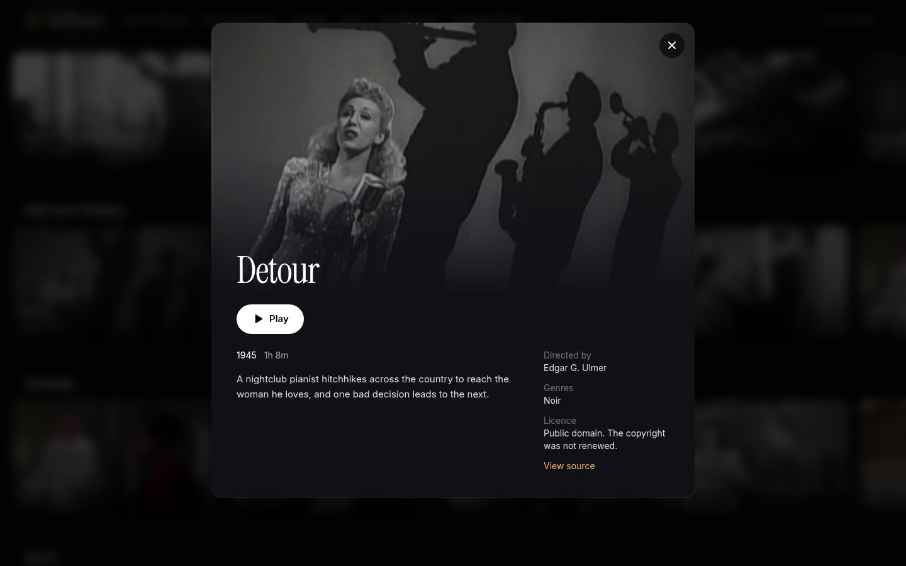
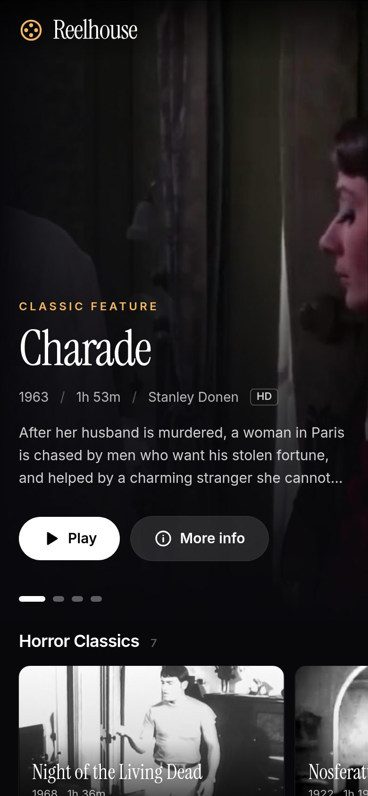

# Reelhouse

A streaming web app for classic films and open movies, built with React, TypeScript and Tailwind CSS. Browse a cinematic home screen, open any title, and press play: every film streams in full, for free, from its legal source.

**Live demo:** https://reelhouse-starlin.vercel.app

Every film in Reelhouse is either in the public domain or released under an open Creative Commons licence. The full list, with the licence basis and source for each title, is at the bottom of this page.

| Home | Player |
| --- | --- |
|  |  |

| Details | Phone |
| --- | --- |
|  |  |

## Features

- **Featured hero** that rotates through four films. After a moment it fades from a still frame into a muted preview of the film itself, with a gradient fade, an unmute button and slide dots.
- **Category rows**: Horror Classics, Noir and Thrillers, Comedy, Sci-fi, The Silent Era and Animated Shorts. Rows use scroll snap, swipe on touch screens and show arrow buttons on desktop.
- **Details sheet** with the synopsis, director, genres, running time, an HD badge where it applies, the licence and a link to the source. It opens as a native dialog, so Escape, focus and the back button all work.
- **Custom video player** built on the HTML video element:
  - play and pause, back and forward 10 seconds, a seek bar that also shows how much has buffered, current time and length, volume slider, mute, full screen
  - keyboard shortcuts: Space or K to play and pause, Left and Right to skip 10 seconds, Up and Down for volume, F for full screen, M for mute, Escape to leave
  - controls fade away while the film plays and come back when you move the mouse or touch the screen
  - loading spinner, and a friendly retry screen if a source is unreachable
  - on iPhone it plays inline and uses the native full screen player
- **Continue watching**: your place in each film is saved on your device every few seconds and when you leave. The row appears at the top of the home screen with a progress bar and time left, and films resume where you stopped. Finished films drop off the row by themselves.
- **Built for phones first**: tested at 390 pixels wide, safe area aware for notched iPhones, large tap targets.
- **Accessible and calm**: visible focus states, labelled controls, and reduced motion respected (no preview video, no animations).

## Tech stack

- React 18 and TypeScript (strict)
- Vite 6
- Tailwind CSS 4
- React Router 7
- Vitest and Testing Library
- Hosted on Vercel

## How it works

**The catalogue** lives in `src/data/films.ts`. Each film has its title, year, director, genres, running time, a synopsis, the direct MP4 address on its legal host, a still frame, the point where its hero preview starts, its source page and its licence. Rows are just genre filters over that list, so adding a film is one entry.

**Video** is never stored in this repository. The player streams H.264 MP4 files straight from the Internet Archive, which supports byte range requests, so seeking jumps to any point without downloading the whole film. Every address was checked before it went in: it answers a range request with `206 Partial Content` and `video/mp4`, and it actually starts playing in a browser.

**Images** are single frames taken from each film with ffmpeg, cropped to 16:9 and saved at two sizes (640 and 1280 wide). Cards load the small one through `srcset`, the hero and details sheet use the large one.

**Continue watching** is a small store in `src/lib/progress.ts` on top of `localStorage`. The core functions take a `Storage` object, which keeps them pure and easy to unit test. It ignores the first 10 seconds (so a quick peek does not count), removes a film when you reach the last 90 seconds, keeps the 20 most recent entries and survives corrupt data. React reads it through `useSyncExternalStore`, so every row updates the moment progress changes, even in another window.

## Design and techniques

Notes for anyone reviewing the code:

1. **Data driven UI.** One typed array drives the hero, the rows, the details sheet and the player. Tests check the catalogue itself: unique ids, https sources on the allowed host, a licence for every film, and enough films for every row.
2. **External store with `useSyncExternalStore`.** Continue watching subscribes to a custom event plus the browser `storage` event, which avoids prop drilling and keeps open windows in sync.
3. **URL as state.** The details sheet is driven by `?film=id`, so a sheet can be shared or reloaded, and the back button closes it. The player lives at `/watch/:id`.
4. **Native dialog.** `<dialog>` with `showModal()` gives focus trapping, Escape to close and a styled backdrop without a library.
5. **Custom media controls.** The seek and volume sliders are real `input type="range"` elements styled with CSS variables, so the played and buffered parts of the track are drawn with one gradient and the controls stay keyboard and screen reader friendly.
6. **Mobile video rules.** `playsInline` everywhere, previews are muted, autoplay failures fall back to a big play button, and full screen falls back to `webkitEnterFullscreen` on iPhone.
7. **Respecting the viewer.** Previews are skipped when the device asks for reduced motion or data saving, and pause when the page is in the background.
8. **Scroll snap rows.** Horizontal rows use CSS scroll snap for native feeling swipes, with arrow buttons that only appear when there is more to scroll.
9. **Performance.** Lazy loaded responsive images, a preconnect to the video host, `preload="none"` on the hero preview until it is needed, and no UI library: the whole app is about 90 KB of JavaScript after gzip.

## Run it locally

```bash
npm install
npm run dev      # http://localhost:5173
npm test         # unit tests
npm run lint
npm run build    # production build in dist/
```

No API keys or environment variables are needed.

## Deploy

The repository is connected to Vercel. Every push to `main` builds and deploys automatically. `vercel.json` sends every route to `index.html` so links like `/watch/sintel` work on refresh.

## Film sources and licences

Classic features are films in the public domain in the United States, either because they were released before 1929, or because they were published without a valid copyright notice or their copyright was not renewed. Open movies are by the Blender Foundation and are shared under Creative Commons Attribution licences; they are credited here and in the app.

| Film | Year | Director | Licence basis | Source |
| --- | --- | --- | --- | --- |
| Night of the Living Dead | 1968 | George A. Romero | Public domain. Released in 1968 without a copyright notice. | [archive.org](https://archive.org/details/night_of_the_living_dead_dvd) |
| Nosferatu | 1922 | F. W. Murnau | Public domain in the US. Released in 1922. | [archive.org](https://archive.org/details/nosferatu-1922_202504) |
| The Cabinet of Dr. Caligari | 1920 | Robert Wiene | Public domain in the US. Released in 1920. | [archive.org](https://archive.org/details/DasKabinettdesDoktorCaligariTheCabinetofDrCaligari) |
| Carnival of Souls | 1962 | Herk Harvey | Public domain. Released in 1962 without a copyright notice. | [archive.org](https://archive.org/details/CarnivalofSouls) |
| House on Haunted Hill | 1959 | William Castle | Public domain. The copyright was not renewed. | [archive.org](https://archive.org/details/The_House_On_Haunted_Hill) |
| The Last Man on Earth | 1964 | Ubaldo Ragona, Sidney Salkow | Public domain. Released in 1964 without a valid copyright notice. | [archive.org](https://archive.org/details/the-last-man-on-earth-1964_20251031) |
| Detour | 1945 | Edgar G. Ulmer | Public domain. The copyright was not renewed. | [archive.org](https://archive.org/details/Detour) |
| Scarlet Street | 1945 | Fritz Lang | Public domain. The copyright was not renewed. | [archive.org](https://archive.org/details/ScarletStreet) |
| The Stranger | 1946 | Orson Welles | Public domain. The copyright was not renewed. | [archive.org](https://archive.org/details/TheStranger_0) |
| D.O.A. | 1949 | Rudolph Maté | Public domain. The copyright was not renewed. | [archive.org](https://archive.org/details/d.-o.-a.-1950) |
| Charade | 1963 | Stanley Donen | Public domain. Released in 1963 without a valid copyright notice. | [archive.org](https://archive.org/details/charade-1963-cary-grant-audrey-hepburn-comedy-mystery-romance-thriller-full-movie) |
| His Girl Friday | 1940 | Howard Hawks | Public domain. The copyright was not renewed. | [archive.org](https://archive.org/details/his_girl_friday) |
| The Little Shop of Horrors | 1960 | Roger Corman | Public domain. Released in 1960 without a copyright notice. | [archive.org](https://archive.org/details/The.Little.Shop.of.Horrors.60) |
| Sherlock Jr. | 1924 | Buster Keaton | Public domain in the US. Released in 1924. | [archive.org](https://archive.org/details/sherlockjr1924_201909) |
| The General | 1926 | Buster Keaton, Clyde Bruckman | Public domain in the US. Released in 1926. | [archive.org](https://archive.org/details/The_General_Buster_Keaton) |
| Safety Last! | 1923 | Fred C. Newmeyer, Sam Taylor | Public domain in the US. Released in 1923. | [archive.org](https://archive.org/details/safety-last-final_202506) |
| Plan 9 from Outer Space | 1959 | Edward D. Wood Jr. | Public domain. The copyright was not renewed. | [archive.org](https://archive.org/details/plan-9-from-outer-space_202009) |
| Teenagers from Outer Space | 1959 | Tom Graeff | Public domain. Released in 1959 without a valid copyright notice. | [archive.org](https://archive.org/details/teenagers_from_outerspace) |
| A Trip to the Moon | 1902 | Georges Méliès | Public domain. Released in 1902. | [archive.org](https://archive.org/details/le-voyage-dans-la-lune-1902-georges-melies) |
| Big Buck Bunny | 2008 | Sacha Goedegebure | CC BY 3.0. Blender Foundation, peach.blender.org | [archive.org](https://archive.org/details/BigBuckBunny_124) |
| Sintel | 2010 | Colin Levy | CC BY 3.0. Blender Foundation, durian.blender.org | [archive.org](https://archive.org/details/Sintel) |
| Tears of Steel | 2012 | Ian Hubert | CC BY 3.0. Blender Foundation, mango.blender.org | [archive.org](https://archive.org/details/Tears-of-Steel) |
| Elephants Dream | 2006 | Bassam Kurdali | CC BY. Blender Foundation and Netherlands Media Art Institute, orange.blender.org | [archive.org](https://archive.org/details/ElephantsDream) |
| Cosmos Laundromat | 2015 | Mathieu Auvray | CC BY 4.0. Blender Institute, gooseberry.blender.org | [archive.org](https://archive.org/details/CosmosLaundromatFirstCycle) |
| Spring | 2019 | Andy Goralczyk | CC BY 4.0. Blender Animation Studio, studio.blender.org | [archive.org](https://archive.org/details/springopenmovie) |

Blender open movies: Big Buck Bunny (c) Blender Foundation, peach.blender.org. Sintel (c) Blender Foundation, durian.blender.org. Tears of Steel (c) Blender Foundation, mango.blender.org. Elephants Dream (c) Blender Foundation and Netherlands Media Art Institute, orange.blender.org. Cosmos Laundromat (c) Blender Institute, gooseberry.blender.org. Spring (c) Blender Animation Studio, studio.blender.org. All used under their Creative Commons Attribution licences.

Some uploads of silent films carry a later musical accompaniment added by the uploader. Reelhouse uses the Internet Archive items listed above, which are marked as public domain by the archive.

## Licence

The code is released under the MIT licence, see [LICENSE](LICENSE). The films keep their own licences listed above.
